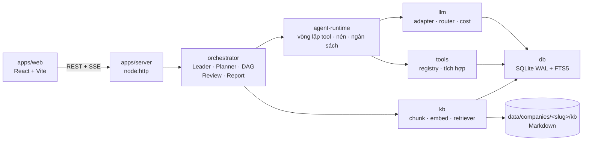

# Đội Agent Marketing

Website tự host cho **một đội agent marketing** vận hành theo từng công ty. Bạn chỉ
nói chuyện với **Leader**; Leader làm rõ yêu cầu, chia việc cho mười chuyên môn
(nghiên cứu, nội dung, SEO, kỹ thuật web, social, quảng cáo, email, thiết kế, phân
tích, chăm sóc cộng đồng), kiểm tra chất lượng rồi trả về **một báo cáo có nguồn và có chi phí**.

Điểm khác biệt không nằm ở chỗ "có nhiều agent". Nó nằm ở chỗ hệ thống **không cho
phép agent bịa**: thiếu dữ liệu thì phải báo bị chặn, thiếu nguồn thì không được
duyệt, vượt ngân sách thì dừng, và mọi hành vi hướng ra công chúng mặc định chỉ tạo
nháp chờ bạn phê duyệt.

Nhiều công ty trên cùng một instance. Mỗi công ty có đội agent, cấu hình model,
kho kiến thức Markdown và **ma trận phân quyền tri thức riêng** — kiểm tra ở tầng
truy vấn, không phải bằng lời dặn trong prompt.

---

## Tính năng chính

**Đính kèm trong trao đổi với Leader**
- Nút **Đính kèm**, kéo thả file hoặc dán ảnh bằng **Ctrl+V**; xem trước, xoá và thử tải lại trước khi gửi. Có thể gửi chỉ file/ảnh mà không nhập chữ.
- Đọc PDF có văn bản, DOCX, TXT, Markdown, CSV, JSON và ảnh PNG/JPG/WebP. Tối đa 5 tệp/lượt, 10 MiB/tệp (ảnh 5 MiB), tổng 20 MiB; tài liệu tối đa 40.000 ký tự/tệp và 60.000 ký tự/lượt. PDF scan cần OCR trước hoặc gửi dưới dạng ảnh.
- Ảnh được truyền thật tới model vision. Trong **Cài đặt → Model**, bật **Hỗ trợ đọc ảnh** cho model có khả năng này, rồi chọn model đó hoặc thêm vào dự phòng cho Leader. Chưa có model phù hợp sẽ báo lỗi và giữ nguyên tệp để thử lại.
- Lượt phân tích dùng model/ngân sách của công ty; không đòi đủ brief để đọc tài liệu. Bản gốc lưu riêng theo hội thoại trong SQLite, tải lại qua API có kiểm quyền; không tự thêm vào kho kiến thức. Tệp chưa gửi được dọn sau 24 giờ khi công ty tải tệp mới.

**Báo cáo công việc hằng ngày cho lãnh đạo**
- Nhóm có danh sách thành viên, link nhập không đăng nhập, cho nộp/sửa bất cứ lúc nào bằng cách chọn tên và đánh dấu ngày nghỉ. Lịch tổng hợp thứ Hai–thứ Bảy chốt lúc 16:50 giờ Việt Nam.
- Lịch chọn ngày hỗ trợ lịch sử và tạo trước ngày tương lai. **Tạo link chia sẻ** cấp hai link riêng để nộp và xem; link xem tự hiển thị bản tổng hợp hoàn tất mới nhất, không cần đăng nhập.
- Bản chốt bất biến, đánh dấu người chưa nộp đúng hạn, giữ riêng bản nộp muộn và bản cập nhật.
- Tổng hợp tiếng Anh bằng model công ty, xuất Word DOCX/PDF. Bạn tự gửi link và tài liệu.
- Thiết lập và giới hạn: [Hướng dẫn báo cáo hằng ngày](docs/bao-cao-hang-ngay.md).

**Cài đặt theo chức năng**
- Sáu tab: Nhà cung cấp & API key, Model, Phân công model, Phân loại tri thức, Kết nối ngoài, Giới hạn chi phí. Giữ nháp khi đổi tab; URL như `#/cai-dat?tab=models` mở đúng phần cần cấu hình.

**Điều phối có kiểm soát**
- **BriefGate** — chặn ở đầu vào: chưa đủ 6 trường (mục tiêu, KPI, phạm vi, thời
  hạn, ngân sách, ràng buộc) thì chưa được tạo việc; Leader hỏi đúng trường còn thiếu.
- **DAG validation** — kế hoạch có chu trình, role không tồn tại, hoặc việc không
  đường tới mục tiêu thì bị từ chối trước khi giao.
- **ReviewGate** — chặn ở đầu ra: checklist 6 mục, không đạt thì trả lại kèm lý do
  cụ thể, tối đa 2 vòng.
- **Budget guard** — ba trần: chi phí mỗi task, chi phí mỗi công ty mỗi ngày, số
  bước model mỗi lượt chạy. Vượt trần là dừng ngay, không tiêu trong im lặng.

**Đội 11 agent, mỗi agent một vai trò và một bộ quyền**
- Leader điều hành + 10 chuyên môn, chia 4 lớp theo phụ thuộc dữ liệu (nghiên cứu →
  nội dung → kênh → đo lường).
- Mỗi agent có model riêng theo tier, skill riêng, tool riêng, và **danh mục tri
  thức đọc/ghi riêng**. Mười chuyên môn có thể hỏi nhau (tối đa 3 vòng) thay vì bịa.
- Chi tiết: [docs/so-do-doi-agent.md](docs/so-do-doi-agent.md).

**Kho kiến thức riêng cho từng công ty**
- Tải file **PDF có văn bản, DOCX, TXT, Markdown** theo công ty (tối đa 10 file/lượt, 10 MiB/file). Chỉ chọn/kéo thả file: tự tải, trích nội dung và AI phân loại từng phần bằng model riêng ở **Cài đặt → Model phân loại kiến thức** hoặc kế thừa model Marketing Leader của công ty, rồi index; không cần chọn danh mục/nhãn. Job xử lý nền lưu bền trong SQLite, lỗi có thể thử lại mà không tải lại file. Cần cấu hình model/khóa và ngân sách công ty; có ghi chi phí model. Index thông thường không gọi phân loại lại; PDF scan/ảnh cần OCR trước khi tải. Không hỗ trợ `.doc`, Excel hoặc file nén.
- Kho kiến thức hiển thị model/provider hiệu lực và model đã gọi gần nhất. Cài đặt model có chế độ riêng/kế thừa, model dự phòng có thứ tự và kiểm tra bằng dữ liệu mẫu (có tính phí model); lưu cấu hình không tự chạy lại tài liệu lỗi. Thiếu model được báo rõ, không tự chọn model có sẵn.
- Giữ bản gốc riêng tư dưới `<KB_ROOT>/.uploads/<companyId>/`, văn bản nguồn trong SQLite; cần sao lưu cả DB và thư mục này. Người dùng có thể xem nội dung trích và tải lại bản gốc qua API có kiểm quyền.
- Phân loại lỗi gateway/model (HTTP 530/5xx/429, timeout) dùng model dự phòng đã cấu hình và tự thử lại có giới hạn. Phân biệt tài liệu chưa phân loại (chưa truy xuất được) với tài liệu có chunks nhưng thiếu vector. Nút xử lý lại hàng loạt không cần upload lại.
- Index lại đưa file chưa phân loại bị lỗi về hàng đợi và xử lý cả tài liệu sẵn sàng trong DB, không yêu cầu có thư mục Markdown. Kho trống không báo lỗi thiếu thư mục; lỗi vector không chặn tìm kiếm từ khóa.
- Markdown + frontmatter, cắt theo heading, tìm kiếm lai **FTS5 từ khoá + vector
  ngữ nghĩa** gộp bằng RRF, trả về kèm nguồn (đường dẫn + heading) để trích dẫn.
- ACL lọc **trước khi xếp hạng**: một chunk bị cấm không thể lọt vào kết quả dù có
  điểm tương đồng cao nhất.
- 6 danh mục: công ty & sản phẩm, thương hiệu & giọng nói, thị trường & đối thủ,
  kênh & playbook, dữ liệu & hiệu suất, kết quả & tài sản.

**Vận hành đơn giản**
- Một tiến trình Node + một file SQLite (WAL). Không service phụ, không message
  queue. Sao lưu là một lệnh `VACUUM INTO`.
- Bí mật mã hoá AES-256-GCM, hoặc chỉ tham chiếu tên biến môi trường. API không bao
  giờ trả key về trình duyệt.
- Đa người dùng: công ty, membership (owner/admin/member/viewer), phiên cookie
  HttpOnly.

**Tích hợp**
- Provider LLM OpenAI-compatible / Anthropic, có router theo tier và capability
  guard (tự chuyển model khi model được chọn không hỗ trợ tool-calling).
- Tool ngoài: Firecrawl (search/scrape), Google Analytics 4, Google Search Console,
  Google Sheets, Meta (insights/publish), LinkedIn, email, Google Ads / Meta Ads.
- Chi phí ghi vào `runs` và cộng dồn `usage_daily`, xem được theo ngày / agent /
  model.

**CampaignLoop cho agency (v1)**
- Agency cha có thể liên kết nhiều client workspace mà vẫn giữ phạm vi dữ liệu theo client.
- Lập lịch nội dung Meta/LinkedIn và email SMTP theo múi giờ IANA của client.
- Policy tự động có quota, giờ yên lặng, kill switch và audit; email chỉ gửi tới contact có consent opt-in.
- Job bền vững trong SQLite có lease, retry, idempotency, provider request id và snapshot metrics thực thi.
- Import CSV consent, unsubscribe token công khai và màn hình CampaignLoop trong giao diện.

---

## Kiến trúc tóm tắt



Quy tắc bất biến: **tầng trên chỉ import tầng dưới**. `shared` không phụ thuộc gì
trong repo; `db` chỉ phụ thuộc `shared`. Nhờ vậy `db` test được mà không cần model,
và `llm` test được mà không cần HTTP.

Hai ràng buộc định hình cả hệ thống:

1. `better-sqlite3` là **đồng bộ, một writer** → transaction ngắn, không bao giờ bắc
   qua `await`, và **không scale ngang**. Triển khai là một instance + một volume.
2. Gateway LLM nội bộ **không hỗ trợ embeddings** → embedding là interface cắm rời
   với ba hiện thực (local ONNX / remote / hash), tự fallback và **ghi log rõ** khi
   fallback.

Đọc đầy đủ quyết định và đánh đổi tại [docs/kien-truc.md](docs/kien-truc.md).

---

## Quick start

Yêu cầu: **Node.js >= 22** và **pnpm 11**.

```bash
# 1. Cấu hình — APP_SECRET là bắt buộc (tối thiểu 16 ký tự; nên >= 32)
cp .env.example .env
openssl rand -base64 48          # dán kết quả vào APP_SECRET= trong .env

# 2. Cài phụ thuộc (store nằm trong repo để tránh lỗi quyền thư mục store mặc định)
pnpm install --store-dir .pnpm-store

# 3. Cài catalog + công ty đầu tiên kèm tài khoản chủ sở hữu
pnpm db:seed --company "Công ty Demo" --email owner@congty.vn --password 'doi-mat-khau-2026' --demo

# 4. Chạy API (terminal 1)
pnpm dev:server        # http://127.0.0.1:3000

# 5. Chạy giao diện (terminal 2) — mở http://127.0.0.1:5173
pnpm dev:web
```

Mở **http://127.0.0.1:5173** (không phải cổng 3000). Vite proxy `/api` sang server
để cookie phiên cùng origin — nếu mở thẳng cổng 3000 mà chưa `pnpm build:web`, bạn
sẽ thấy "Chưa có bản dựng giao diện".

Chạy production:

```bash
pnpm build:web && NODE_ENV=production pnpm start
```

> Chỉ đặt `NODE_ENV=production` khi đã có HTTPS phía trước: khi đó cookie phiên được
> gắn cờ `Secure` và trình duyệt sẽ không gửi qua HTTP.

Đưa nội dung Markdown vào kho kiến thức:

```bash
pnpm kb:index --company cong-ty-demo          # đọc data/companies/<slug>/kb
pnpm kb:index --company cong-ty-demo --watch  # index lại mỗi khi lưu file
```

> `--demo` ở bước 3 chỉ ghi tài liệu mẫu vào **DB**, không tạo file `.md` trên đĩa.
> Muốn dùng `kb:index` và chế độ `--watch`, hãy đặt nội dung Markdown vào
> `data/companies/<slug>/kb/` trước. Chi tiết: [docs/van-hanh.md](docs/van-hanh.md) §3.4.

Cài đặt, biến môi trường, sao lưu/phục hồi và xử lý sự cố: [docs/van-hanh.md](docs/van-hanh.md).

---

## Danh sách màn hình giao diện

Theo thiết kế chốt trong [docs/kien-truc.md](docs/kien-truc.md) §3 và các endpoint
trong [docs/api.md](docs/api.md):

| # | Màn hình | Việc người dùng làm ở đó |
|---|---|---|
| 1 | **Đăng nhập / Đăng ký** | Tạo tài khoản, đăng nhập, chọn công ty |
| 2 | **Chat Leader** | Trình bày yêu cầu, trả lời câu hỏi làm rõ, duyệt kế hoạch, theo dõi tiến độ trực tiếp qua SSE, nhận báo cáo |
| 2b | **CampaignLoop** | Tạo lịch nội dung/email, bật policy, import consent, theo dõi job và dừng khẩn cấp |
| 3 | **Công việc** | Xem DAG và trạng thái từng task, đọc kết quả, phê duyệt hoặc yêu cầu sửa |
| 4 | **Đội agent** | Bật/tắt agent, đổi model/tier, cấp skill và tool, chỉnh danh mục tri thức được đọc/ghi |
| 5 | **Kho kiến thức** | Duyệt tài liệu theo 6 danh mục, thêm/sửa/xoá, xem chỉ mục và lỗi index, reindex |
| 6 | **Cài đặt** | Nhà cung cấp + model + giá, route theo tier, tích hợp ngoài, giới hạn ngân sách |
| 7 | **Chi phí** | Token/chi phí theo ngày, theo agent, theo model; lịch sử run; nhật ký kiểm toán |
| 8 | **Sơ đồ** | Sơ đồ đội agent đọc dữ liệu sống từ `/api/companies/:id/diagram` |

> **Trạng thái:** các màn hình chính và module route đã có trong mã hiện tại. CampaignLoop
> là lớp mới, đang được hoàn thiện thêm connector metrics ngoài snapshot thực thi.
> Phần lõi (schema, seed, llm, kb, agent-runtime, orchestrator, server và web) có test
> theo package; tài liệu API là nguồn tham khảo và mã nguồn là nguồn thực thi.

---

## Tài liệu

| Tài liệu | Nội dung |
|---|---|
| [docs/README.md](docs/README.md) | Mục lục + bản đồ mã nguồn + thứ tự đọc cho người mới |
| [docs/van-hanh.md](docs/van-hanh.md) | Cài đặt, biến môi trường, dev/production, Docker, **sao lưu & phục hồi**, `APP_SECRET`, migration, xử lý sự cố, bảo mật |
| [docs/kien-truc.md](docs/kien-truc.md) | Kiến trúc, 5 quyết định, schema, ranh giới tin cậy, ngưỡng nâng cấp |
| [docs/so-do-doi-agent.md](docs/so-do-doi-agent.md) | 10 agent, phân lớp, ma trận phân quyền tri thức, chiến lược model |
| [docs/luong-hoat-dong.md](docs/luong-hoat-dong.md) | Luồng end-to-end, 2 state machine, 4 cơ chế kiểm soát, xử lý sự cố |
| [docs/api.md](docs/api.md) | Bảng endpoint, quyền yêu cầu, hình dạng phản hồi, định dạng SSE |

---

## Chưa làm được — nói thẳng

- **Chưa render ảnh/video thật.** `design-video` sinh spec, storyboard và prompt mô
  tả, không có bước render.
- **Google Ads / Meta Ads mới ở mức khuôn.** Tool mặc định chỉ trả **kế hoạch cấu
  trúc**; chỉ gửi lên nền tảng khi gọi với `apply = true` sau phê duyệt, và cần
  developer token + tài khoản liên kết. Chưa kiểm chứng end-to-end với tài khoản thật.
- **Chưa có billing nhiều tổ chức.** Không có bảng gói/đăng ký trả tiền, không giới
  hạn theo gói.
- **Một instance, không scale ngang.** SQLite một writer. Ngưỡng và đường nâng cấp
  (Postgres, `sqlite-vec`/pgvector, hàng đợi ngoài) ghi ở
  [docs/kien-truc.md](docs/kien-truc.md) §7.
- **Embedding local không kèm sẵn.** Bản cài mặc định rơi về `hash` (tìm kiếm từ
  khoá vẫn đầy đủ, tìm kiếm ngữ nghĩa yếu). Cách bật: [docs/van-hanh.md](docs/van-hanh.md) §11.5.
- **Chưa có Dockerfile / docker-compose trong repo.** Thiết kế triển khai đã chốt ở
  [docs/van-hanh.md](docs/van-hanh.md) §6 và ghi rõ file chưa tồn tại.
- **Metrics bên ngoài chưa polling tự động.** CampaignLoop ghi snapshot accepted/published
  sau execution; đồng bộ insights Meta/LinkedIn định kỳ sẽ là bước tiếp theo.

---

## Kiểm thử

```bash
pnpm typecheck    # tsc -b
pnpm test         # vitest run
```

Test chạy với provider LLM **giả** (không cần mạng) và embedding `hash` (tất định,
offline). Smoke test gọi gateway thật chỉ chạy khi đặt `LLM_LIVE=1`.
Luồng đăng bài bằng trình duyệt và cấu hình worker trên VPS: [Trình duyệt xã hội](docs/trinh-duyet-xa-hoi.md).

Quản trị WordPress, SEO, Lighthouse và plugin kết nối: [Hướng dẫn WordPress](docs/wordpress.md).
