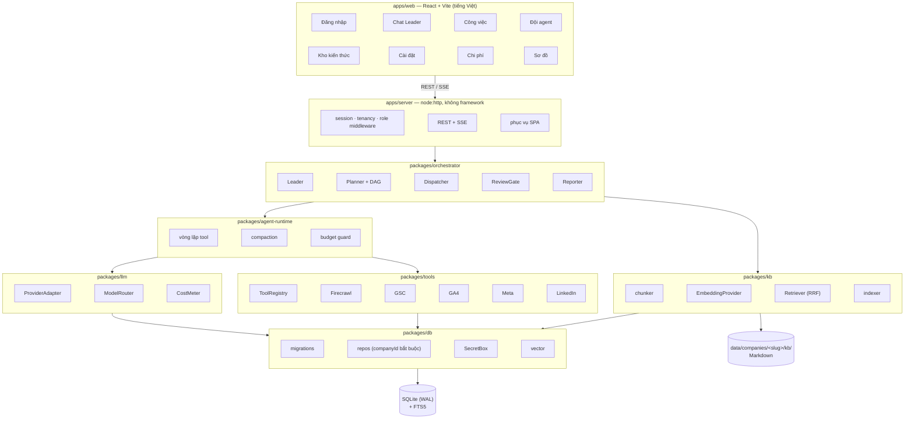
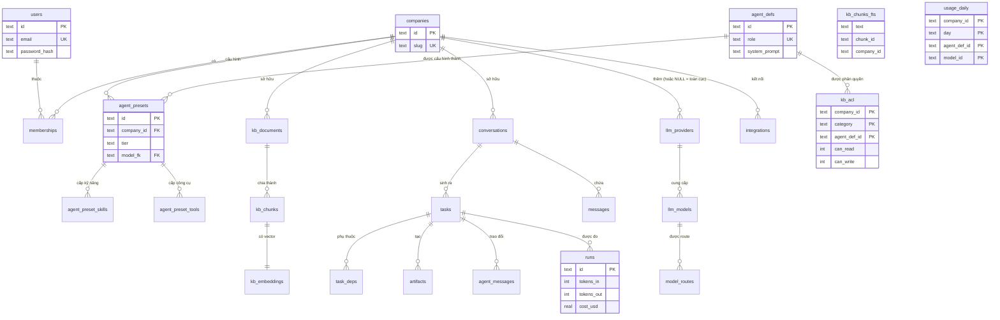
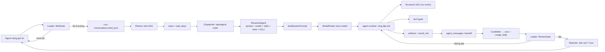

# Kiến trúc hệ thống

## 1. Bài toán và ràng buộc

Cần một **website nhiều người dùng**, mỗi công ty có một vùng làm việc riêng với
kho kiến thức và một đội agent marketing. Người dùng chỉ nói chuyện với Leader;
Leader chia việc cho chuyên môn, nhận kết quả và trả báo cáo.

**Ràng buộc đã kiểm chứng trong quá trình khảo sát môi trường** — đây là cơ sở
cho các quyết định bên dưới:

| Phát hiện | Hệ quả thiết kế |
|---|---|
| Gateway LLM OpenAI-compatible đang chạy tại `http://localhost:20128/v1`, phục vụ **722 model** thuộc nhiều provider (`combo`, `cx`, `openrouter`, …) | Một `llm_providers` row là đủ để tiếp cận nhiều model; **không cần viết adapter riêng cho từng nhà cung cấp** |
| Gateway **yêu cầu API key** (gọi không key → `Missing API key`) | Key phải được quản lý qua tham chiếu env hoặc mã hoá trong DB, không hard-code |
| Gateway **hỗ trợ function calling** (`finish_reason: "tool_calls"`, trả `tool_calls` chuẩn OpenAI) | Dùng được vòng lặp tool chuẩn; không cần cơ chế giả lập tool |
| Gateway **KHÔNG hỗ trợ embeddings** (`/v1/embeddings` → 400) | Bắt buộc có embedding provider riêng; mặc định chạy local, fallback sang hash |
| Docker Engine 29.8.1 khả dụng, Node 22, pnpm 11 | Đóng gói bằng Docker; không cần cài runtime lạ |
| SQLite được chọn (`better-sqlite3`), có FTS5 | Vector search chạy brute-force trong app; FTS5 lo phần từ khoá |

---

## 2. Quyết định kiến trúc

### 2.1 Orchestrator tự viết, không nhúng DSH

DSH (DeepSeek Harness) đã có sẵn `subagent`, `skill`, `workspace`, `agent-team`.
Ta **không** nhúng nó, vì yêu cầu là một website độc lập nhiều người dùng. DSH
được dùng làm **nguồn tham chiếu thiết kế**: mô hình `agent_defs`/`agent_presets`
tương ứng cách DSH tách agent-preset khỏi agent-def; `kb_acl` tương ứng cơ chế
skill-scoping theo scope; `agent_messages` tương ứng mailbox của agent-team.

*Đánh đổi:* phải tự viết vòng lặp tool và quản lý context. *Được:* không phụ
thuộc vào một runtime nặng, và kiểm soát hoàn toàn schema đa tenant — thứ mà một
runtime dùng chung session khó đáp ứng.

### 2.2 Một tiến trình Node, SQLite trên volume

`better-sqlite3` là **đồng bộ, một writer**. Điều này định hình cả hệ thống:

- Transaction phải **ngắn** và **không bao giờ** bắc qua một `await`.
- Orchestrator chạy async **ngoài** transaction, chỉ commit kết quả.
- Ghi được tuần tự hoá bởi event loop — không cần lock nghiệp vụ.
- **Không scale ngang.** Triển khai là một instance + một volume bền vững.

*Vì sao chấp nhận:* quy mô mục tiêu là một nhóm người dùng trên mỗi công ty, tải
ghi thấp. Đổi lại được vận hành cực đơn giản: một file, một lệnh backup, không có
service phụ. Khi vượt ngưỡng, `packages/db` là tầng duy nhất phải thay.

### 2.3 Phân quyền ở tầng truy vấn, không ở prompt

Mọi bảng nghiệp vụ mang `company_id`, và mọi truy vấn đi qua lớp repo bắt buộc
nhận `companyId`. Với kho kiến thức, `kb_acl` được áp **trước khi xếp hạng**, nên
một chunk bị cấm không thể lọt vào kết quả ngay cả khi điểm tương đồng cao nhất.

*Vì sao không chỉ dặn trong prompt:* prompt là gợi ý, không phải hàng rào. Nếu
việc bảo vệ dữ liệu phụ thuộc vào việc model nghe lời, hệ thống không có bảo vệ.

### 2.4 Bí mật chỉ ở hai dạng: mã hoá hoặc tham chiếu env

API key của provider và credential của tích hợp được mã hoá AES-256-GCM (khoá
dẫn xuất từ `APP_SECRET` bằng scrypt) trước khi lưu. Một lựa chọn khác là chỉ lưu
**tên biến môi trường** (`api_key_ref`) — dùng cho key của deployment. API không
bao giờ trả key về trình duyệt; chỉ trả `apiKeyConfigured` và 4 ký tự cuối.

Key được **giải mã lại ở mỗi request**, không cache: nhờ vậy xoay key trong giao
diện có hiệu lực ngay ở request kế tiếp, không cần restart.

### 2.5 Embedding cắm rời, mặc định chạy local

Gateway không có embeddings, nên `EmbeddingProvider` là interface với ba hiện
thực: `local` (ONNX trong tiến trình), `remote` (OpenAI-compatible), `hash` (tất
định, cho test/offline). `createEmbeddingProvider()` tự fallback sang `hash` khi
model local không có sẵn, và **ghi log rõ đã fallback** — im lặng fallback sẽ tạo
ra một hệ thống tìm kiếm kém chất lượng mà không ai biết.

---

## 3. Các tầng

**Quy tắc phụ thuộc:** mỗi tầng chỉ được import tầng bên dưới nó. `shared` không
import gì trong repo. `db` chỉ import `shared`. Tầng trên không bao giờ bị tầng
dưới import ngược — nhờ vậy `db` test được mà không cần model, và `llm` test được
mà không cần HTTP.

---

## 4. Schema cơ sở dữ liệu

Bảy migration, chạy một lần và ghi vào `schema_migrations`. Migration là
**append-only** — đã phát hành thì không sửa, chỉ thêm mới.

**Bảng `kb_chunks_fts` là bảng ảo FTS5** (không có khoá ngoại), nên khi thay
chunk phải xoá FTS **trước** khi xoá chunk — thứ tự ngược lại sẽ để lại rác mồ
côi. Chi tiết này được ghi chú ngay tại `KnowledgeRepo.replaceChunks`.

---

## 5. Luồng dữ liệu một lượt chạy agent

---

## 6. Ranh giới tin cậy

| Ranh giới | Kiểm soát |
|---|---|
| Trình duyệt → Server | Cookie session HttpOnly + SameSite=Lax; Secure khi production |
| Người dùng → Công ty | `requireMembership` tra DB; không tin `companyId` từ client |
| Công ty → Công ty | Mọi truy vấn repo bắt buộc `companyId`; test cô lập phải fail-closed |
| Vai trò → Thao tác | `requireManage` (owner/admin) cho cấu hình; `requireWork` (trừ viewer) cho việc |
| Model → Dữ liệu | ACL lọc ở tầng SQL trước khi xếp hạng, không dựa vào prompt |
| Model → Tool | Registry kiểm tra grant của preset; tool ngoài grant trả lỗi, không chạy |
| Model → Hành vi công khai | `requireApproval` mặc định bật: đăng bài/gửi email tạo nháp chờ duyệt |
| Server → Bí mật | AES-256-GCM; API chỉ trả `apiKeyConfigured` + 4 ký tự cuối |
| Bí mật → Log | Không log giá trị; lỗi giải mã báo cấu hình chứ không in bí mật |

---

## 7. Ngưỡng cần nâng cấp

Thiết kế này có giới hạn đã biết. Khi chạm ngưỡng, đây là đường nâng cấp:

| Ngưỡng | Biểu hiện | Nâng cấp |
|---|---|---|
| > ~10⁵ chunk/công ty | Truy vấn vector chậm dần (brute-force cosine trong JS) | Chuyển sang `sqlite-vec` hoặc pgvector + HNSW; tầng `vector.ts` là điểm thay duy nhất |
| > ~20 người dùng đồng thời ghi | `SQLITE_BUSY` xuất hiện | Chuyển `packages/db` sang Postgres; repo API giữ nguyên |
| Cần nhiều instance | SQLite không chia sẻ được | Postgres + chuyển orchestrator sang hàng đợi ngoài |
| Kho tri thức rất lớn | Embedding local chậm khi index | Dùng `EMBEDDING_PROVIDER=remote` với provider trả phí |
| Nhiều tổ chức trả tiền | Cần billing, giới hạn theo gói | Thêm bảng `plans`/`subscriptions`; budget guard đã có sẵn để tái dùng |
