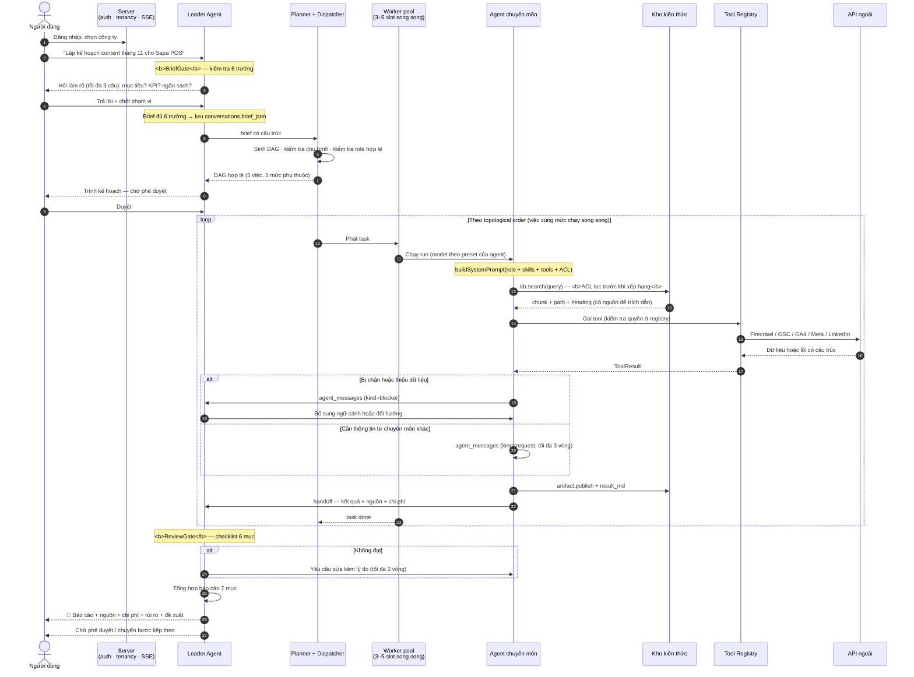
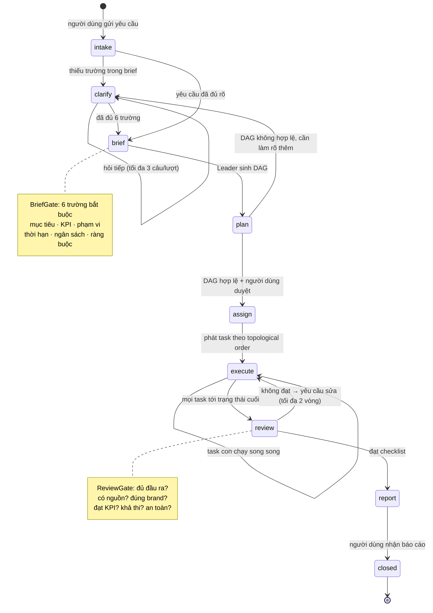
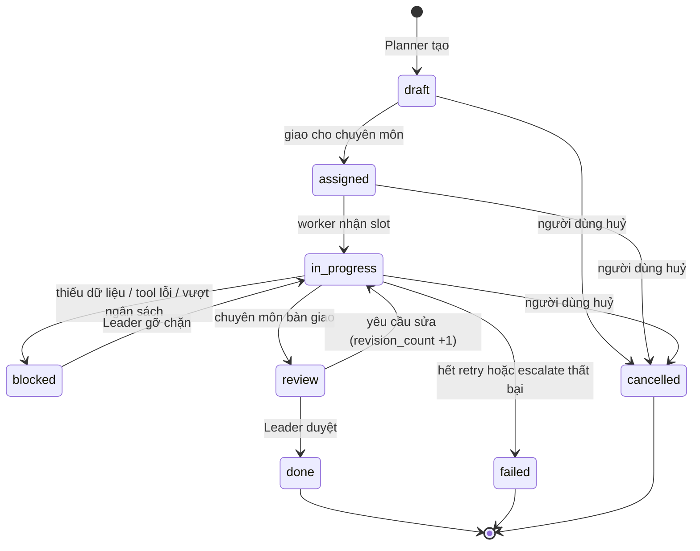

# Luồng hoạt động

Tài liệu này mô tả hệ thống chạy như thế nào khi người dùng đặt một yêu cầu
marketing: từ câu chat đầu tiên tới báo cáo cuối cùng, kèm các trạng thái và
điểm kiểm soát.

---

## 1. Luồng end-to-end

---

## 2. State machine của một phiên làm việc

`conversations.phase` đi qua các trạng thái sau. Mỗi bước có điều kiện vào rõ
ràng, nên không có đường nào để một kế hoạch được giao việc khi brief còn thiếu.

---

## 3. Trạng thái của một công việc (task)

`done`, `failed`, `cancelled` là trạng thái cuối. Lớp repo **từ chối** chuyển một
task đã ở trạng thái cuối sang trạng thái đang chạy — muốn làm lại thì phải tạo
task mới, nhờ vậy lịch sử chi phí và kết quả không bị ghi đè.

---

## 4. Bốn cơ chế kiểm soát

### 4.1 BriefGate — chặn ở đầu vào

Trước khi được phép tạo task, Leader phải chốt đủ 6 trường: **mục tiêu, KPI, phạm
vi, thời hạn, ngân sách, ràng buộc**. Thiếu trường nào thì hỏi đúng trường đó,
tối đa 3 câu một lượt, và **không tự suy diễn**.

*Vì sao:* chi phí sửa sai tăng theo cấp số nhân theo tiến độ. Một KPI mơ hồ được
phát hiện ở bước này tốn một câu hỏi; phát hiện sau khi 8 agent đã chạy tốn cả
lượt làm việc.

### 4.2 DAG validation — chặn kế hoạch sai

Planner kiểm tra trước khi giao việc: mọi `role` tồn tại và đang bật, đồ thị
không có chu trình, mỗi task có ít nhất một đầu ra kiểm chứng được, mọi task đều
có đường tới mục tiêu đã chốt. Không đạt thì trả lỗi cho Leader để sửa kế hoạch,
chứ không giao việc rồi mới phát hiện.

### 4.3 ReviewGate — chặn ở đầu ra

Leader kiểm tra theo checklist 6 mục trước khi duyệt: đủ đầu ra đã cam kết? mọi
số liệu có nguồn? đúng brand voice? đạt KPI? khả thi trong ngân sách? có tuyên
bố cần rà soát pháp lý? Không đạt thì trả lại **kèm lý do cụ thể và ví dụ trong
nội dung**, tối đa 2 vòng.

### 4.4 Budget guard — chặn chi phí

Ba trần: chi phí một task, chi phí một công ty mỗi ngày, số bước model một lượt
chạy. Vượt trần thì run dừng ngay với trạng thái `budget_exceeded`, task chuyển
`blocked`, và người dùng được thông báo kèm số đã dùng. Không có đường nào để một
vòng lặp agent tiêu hết ngân sách trong im lặng.

---

## 5. Khi có sự cố

| Tình huống | Hệ thống làm gì | Người dùng thấy gì |
|---|---|---|
| Provider trả 429 / 5xx | Backoff mũ, retry có giới hạn, rồi escalate model cùng tier | Task chậm hơn; nếu vẫn lỗi thì task `failed` kèm lý do |
| Model không hỗ trợ tool | Capability guard tự chọn model cùng provider có `supports_tools` | Không thấy gì; lý do được ghi vào `runs` |
| Vượt context | Nén phần cũ thành tóm tắt có cấu trúc, thu nhỏ top-K tri thức | Không thấy gì; bản ghi nén lưu trong `messages.meta_json` |
| Vượt ngân sách | Dừng run, task `blocked` | Thông báo kèm số token/chi phí đã dùng và cách tăng trần |
| Tool ngoài chưa kết nối | Trả lỗi cấu trúc `needs_configuration` | Agent đề nghị bạn kết nối; **không** bịa số liệu |
| Agent hỏi agent vô hạn | Giới hạn 3 vòng `request/reply` cho mỗi cặp trong một task | Task `blocked` kèm nội dung còn vướng |
| DAG có chu trình | Planner từ chối, trả lỗi cho Leader | Leader trình kế hoạch đã sửa |
| Truy cập chéo công ty | Lớp repo bắt buộc `companyId`; middleware trả 404 | "Không tìm thấy công ty" |
| SQLite bị khoá | WAL + `busy_timeout` 5s + hàng đợi ghi tuần tự | Không thấy gì ở tải bình thường |
| Index tri thức gián đoạn | `kb_index_jobs` ghi `failed`; index lại theo tài liệu | Màn hình Kho kiến thức hiện trạng thái lỗi |
| Mất `APP_SECRET` | Không giải mã được bí mật đã lưu | Lỗi cấu hình rõ ràng, không rò rỉ giá trị |

---

## 6. Trao đổi giữa các agent

Có hai kênh, cả hai đều được lưu lại để đọc được lịch sử:

**Handoff (bàn giao dọc).** Chuyên môn → Leader, khi task xong hoặc bị chặn.
Gồm: tóm tắt 3–7 gạch đầu dòng, danh sách artifact, rủi ro, và nếu bị chặn thì
"đang thiếu gì, đã thử gì, 2 phương án".

**Peer ask (hỏi ngang).** Chuyên môn ↔ chuyên môn, khi cần thông tin cụ thể mà
bên kia đang giữ. Dùng `agent_messages` với `kind = request`/`reply`, giới hạn 3
vòng cho mỗi cặp trong một task. Ví dụ thực tế: `content-writer` cần số liệu thị
trường → hỏi `market-research` thay vì tự bịa.

*Vì sao giới hạn số vòng:* hai agent lịch sự có thể hỏi qua lại mãi. Giới hạn
biến một vòng lặp vô hạn thành một task `blocked` mà Leader nhìn thấy và xử lý.

---

## 7. Sau khi có báo cáo

Báo cáo có 7 mục cố định, và mục quan trọng nhất là mục đầu:

1. **Tóm tắt điều hành** — 5 dòng cho người bận: đã làm gì, kết quả chính, cần quyết định gì
2. **Kết quả theo mục tiêu** — đối chiếu từng KPI đã chốt
3. **Bằng chứng & nguồn** — tài liệu và tool đã dùng
4. **Chi phí & thời gian** — token/chi phí thật từ `usage_daily`
5. **Rủi ro & giả định** — điều gì có thể làm kết quả sai
6. **Đề xuất bước tiếp theo** — tối đa 3 việc, xếp theo tác động/chi phí
7. **Phụ lục** — liên kết tới artifact đã tạo

Mọi hành vi hướng ra ngoài (đăng bài, gửi email, chạy quảng cáo) mặc định **tạo
bản nháp và chờ bạn phê duyệt**. Đây là lựa chọn có chủ đích: hệ thống chưa đủ
tin cậy để tự phát ngôn thay thương hiệu của bạn, và một bài đăng sai không rút
lại được.
