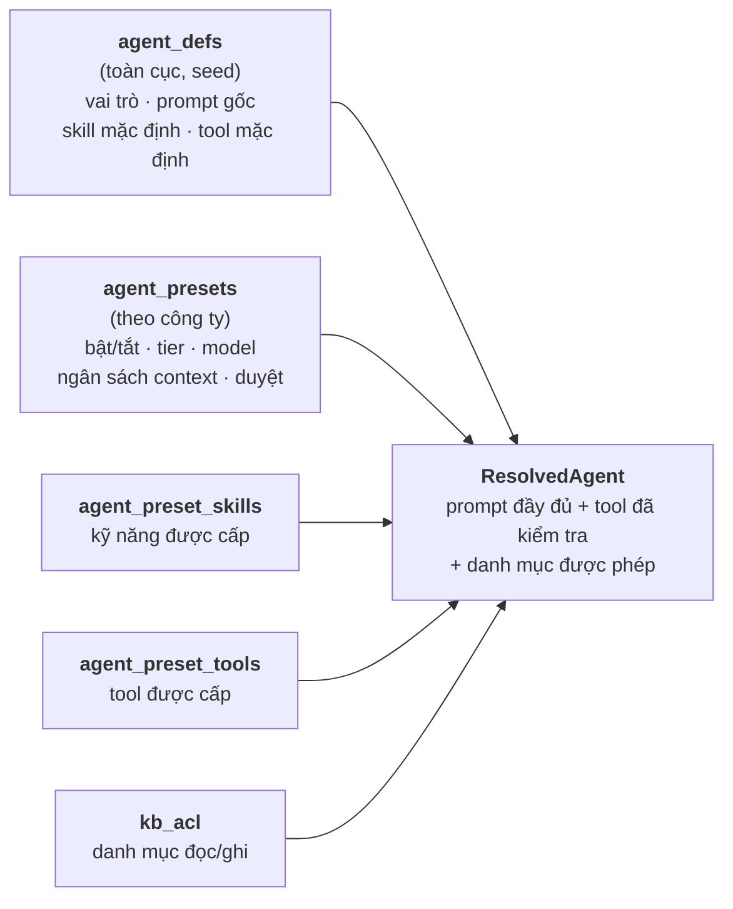

# Sơ đồ đội agent marketing

Tài liệu này là nguồn tham chiếu cho **cấu trúc đội agent**: ai làm gì, đọc được
tri thức nào, dùng công cụ gì, và chạy model nào. Sơ đồ trong ứng dụng (màn hình
**Sơ đồ**) đọc dữ liệu sống từ `/api/companies/:id/diagram`, nên khi bạn đổi cấu
hình trong giao diện thì sơ đồ trong app đổi theo. Tài liệu này mô tả **cấu trúc
đội** và cấu hình gợi ý; cột model chỉ là ví dụ — model thật do bạn chọn trong
Cài đặt → Đội agent, và hệ thống không tự gắn model cho agent.

---

## 1. Sơ đồ tổng thể

```mermaid
flowchart TD
    U["👤 Người dùng<br/>(đăng nhập, thuộc 1+ công ty)"]

    subgraph LEADER["🎯 Lớp điều hành"]
        L["<b>marketing-leader</b><br/>Trưởng phòng Marketing<br/><i>deepseek-v4-pro · tier deep</i><br/>Làm rõ brief · chia việc · kiểm tra · báo cáo"]
    end

    subgraph L1["📚 Lớp nghiên cứu &amp; chiến lược"]
        A1["<b>market-research</b><br/>Nghiên cứu thị trường<br/><i>flash</i>"]
        A3["<b>seo-technical</b><br/>SEO kỹ thuật<br/><i>flash</i>"]
    end

    subgraph L2["✍️ Lớp nội dung &amp; sáng tạo"]
        A2["<b>content-writer</b><br/>Viết nội dung<br/><i>flash</i>"]
        A7["<b>design-video</b><br/>Thiết kế &amp; Video<br/><i>flash</i>"]
    end

    subgraph L3["📣 Lớp kênh &amp; thực thi"]
        A4["<b>social-media</b><br/>Social Media<br/><i>flash</i>"]
        A5["<b>paid-media</b><br/>Quảng cáo trả phí<br/><i>flash → pro</i>"]
        A6["<b>email-crm</b><br/>Email &amp; CRM<br/><i>flash</i>"]
        A10["<b>web-technical</b><br/>Kỹ thuật Web &amp; IT<br/><i>flash</i>"]
    end

    subgraph L4["📈 Lớp đo lường &amp; chăm sóc"]
        A8["<b>analytics</b><br/>Phân tích &amp; Báo cáo<br/><i>pro · tier deep</i>"]
        A9["<b>community-care</b><br/>Chăm sóc cộng đồng<br/><i>flash</i>"]
    end

    KB[("🗄️ Kho kiến thức công ty<br/>Markdown + FTS5 + Vector<br/>6 danh mục, phân quyền theo agent")]
    TL[("🧰 Tool Registry<br/>đã kiểm tra theo quyền của preset")]
    EXT["🌐 API ngoài<br/>Firecrawl · GSC · GA4<br/>Meta · LinkedIn · Sheets"]

    U -->|"yêu cầu / trả lời / phê duyệt"| L
    L -->|"giao việc (task DAG)"| A1 & A2 & A3 & A4 & A5 & A6 & A7 & A8 & A9 & A10
    A1 & A2 & A3 & A4 & A5 & A6 & A7 & A8 & A9 & A10 -->|"handoff: kết quả + nguồn"| L
    A1 & A2 & A3 & A4 & A5 & A6 & A7 & A8 & A9 & A10 <-.->|"hỏi đáp ngang hàng<br/>(tối đa 3 vòng)"| A1
    A1 & A2 & A3 & A4 & A6 & A7 & A8 & A9 & A10 -->|"đọc (đã lọc theo ACL)"| KB
    A1 & A3 & A8 & A10 -->|"ghi kết quả nghiên cứu/kỹ thuật"| KB
    A3 & A4 & A5 & A6 & A8 & A9 & A10 --> TL
    TL --> EXT
    L -->|"📄 báo cáo tổng hợp + nguồn + chi phí"| U

    classDef leader fill:#1B5E4A,stroke:#0d3a2c,color:#fff
    classDef spec fill:#FAF9F6,stroke:#1B5E4A,color:#1A1A1A
    classDef store fill:#F2B705,stroke:#a67c00,color:#1A1A1A
    class L leader
    class A1,A2,A3,A4,A5,A6,A7,A8,A9,A10 spec
    class KB,TL store
```

---

## 2. Vì sao cấu trúc này

**Một điểm chạm duy nhất.** Người dùng chỉ nói chuyện với Leader. Nếu để
chuyên môn nói trực tiếp với người dùng, ngữ cảnh sẽ phân tán và người dùng phải
tự điều phối — đúng việc mà hệ thống này sinh ra để làm thay.

**Leader không tự làm chuyên môn.** Nếu Leader tự viết nội dung, nó sẽ không
còn thời gian kiểm tra chất lượng, và chất lượng đầu ra trở nên phụ thuộc vào một
model duy nhất. Ranh giới này cũng khiến việc kiểm tra có ý nghĩa: người kiểm tra
khác người làm.

**Phân lớp theo phụ thuộc dữ liệu.** Nghiên cứu chạy trước vì nó tạo dữ liệu nền.
Nội dung cần dữ liệu đó. Kênh cần nội dung. Đo lường chạy sau để đánh giá. Đây
chính là thứ tự phụ thuộc mà Planner dùng để dựng DAG.

**Lớp dọc: chín chuyên môn.** Vai trò nội dung và sáng tạo tách khỏi vai trò kênh
vì một người viết giỏi không nhất thiết biết tối ưu ngân sách quảng cáo, và gộp
lại sẽ làm prompt mơ hồ.

---

## 3. Danh sách agent đầy đủ

| # | Vai trò (`role`) | Tên hiển thị | Nhiệm vụ chính | Model gợi ý | Kỹ năng nạp sẵn | Công cụ được cấp | Danh mục tri thức đọc | Ghi |
|---|---|---|---|---|---|---|---|---|
| 1 | `marketing-leader` | Trưởng phòng Marketing | Làm rõ & chốt brief, chia việc, điều phối, kiểm tra chất lượng, tổng hợp báo cáo | `deepseek-v4-pro` | brief-intake, task-decomposition, quality-review, report-writing | `kb_search`, `kb_read`, `artifact_publish`, `agent_ask`, `blocker_report` | **tất cả (6/6)** | Ghi được `90-ket-qua` |
| 2 | `market-research` | Nghiên cứu thị trường | Thị trường, đối thủ, ICP, xu hướng, đề xuất định vị | `deepseek-v4-flash` | market-research, competitor-analysis, persona-building | `kb_search`, `kb_read`, `kb_write`, `web_search`, `web_scrape`, `competitor_watch`, `artifact_publish`, `agent_ask`, `agent_escalate` | `00-cong-ty`, `20-thi-truong`, `30-kenh` | Ghi `20-thi-truong` |
| 3 | `content-writer` | Viết nội dung | Bài SEO, content social, email, landing copy | `deepseek-v4-flash` | copywriting, seo-writing, brand-voice | `kb_search`, `kb_read`, `files_write`, `artifact_publish`, `agent_ask`, `agent_escalate` | `00`, `10-brand`, `20`, `30-kenh` | Chỉ đọc — không ghi KB |
| 4 | `seo-technical` | SEO kỹ thuật | Audit kỹ thuật, từ khoá → cluster, brief SEO, schema/sitemap | `deepseek-v4-flash` | keyword-research, technical-seo-audit, seo-writing | `kb_search`, `kb_read`, `kb_write`, `gsc_query`, `gsc_inspect_url`, `web_search`, `http_fetch`, `artifact_publish`, `agent_ask`, `agent_escalate` | `00`, `30-kenh`, `40-du-lieu`, `90-ket-qua` | Ghi `30-kenh` |
| 5 | `web-technical` | Kỹ thuật Web & IT | Quản trị website, sửa nội dung/giao diện web, gắn mã tracking, bảo trì kỹ thuật | `deepseek-v4-flash` | website-editing, web-technical-maintenance, technical-seo-audit | `kb_search`, `kb_read`, `kb_write`, `files_read`, `files_write`, `wordpress_*`, `http_fetch`, `web_search`, `web_scrape`, `artifact_publish`, `agent_ask`, `agent_escalate` | `00`, `30-kenh`, `40-du-lieu`, `90-ket-qua` | Ghi `30-kenh`, `90-ket-qua` |
| 6 | `social-media` | Social Media | Lịch đăng, caption, hashtag, brief visual | `deepseek-v4-flash` | content-calendar, social-copywriting, brand-voice | `kb_search`, `kb_read`, `files_write`, `meta_publish`, `linkedin_publish`, `meta_insights`, `artifact_publish`, `agent_ask`, `agent_escalate` | `00`, `10-brand`, `20`, `30-kenh` | Đăng công khai cần duyệt |
| 7 | `paid-media` | Quảng cáo trả phí | Cấu trúc campaign, audience, ngân sách, A/B, tối ưu CPL/ROAS | `flash` → `pro` khi escalate | campaign-structure, audience-targeting, budget-optimization | `kb_search`, `kb_read`, `kb_write`, `meta_insights`, `ads_meta`, `ads_google`, `artifact_publish`, `agent_ask`, `agent_escalate` | `00`, `20`, `30-kenh`, `40-du-lieu` | Không tự tăng ngân sách |
| 8 | `email-crm` | Email & CRM | Chuỗi nurture, phân nhóm, automation, A/B tiêu đề | `deepseek-v4-flash` | email-sequence, crm-segmentation, copywriting | `kb_search`, `kb_read`, `email_send`, `sheets_write`, `artifact_publish`, `agent_ask`, `agent_escalate` | `00`, `10-brand`, `40-du-lieu` | `email_send` mặc định **tắt** |
| 9 | `design-video` | Thiết kế & Video | Brief thiết kế, storyboard, spec kích thước, prompt mô tả | `deepseek-v4-flash` | creative-brief, storyboarding | `kb_search`, `kb_read`, `files_write`, `artifact_publish`, `agent_ask`, `agent_escalate` | `00`, `10-brand`, `30-kenh` | Sinh spec, không render nặng |
| 10 | `analytics` | Phân tích & Báo cáo | Đo KPI kênh/phễu, phát hiện bất thường, báo cáo định kỳ | `deepseek-v4-pro` | data-analysis, kpi-reporting, anomaly-detection | `kb_search`, `kb_read`, `kb_write`, `gsc_query`, `sheets_write`, `artifact_publish`, `agent_ask`, `agent_escalate` | `00`, `30-kenh`, `40-du-lieu`, `90-ket-qua` | Ghi `40-du-lieu` |
| 11 | `community-care` | Chăm sóc cộng đồng | Trả lời bình luận/tin nhắn, moderation, leo thang khủng hoảng | `deepseek-v4-flash` | community-response, crisis-escalation, brand-voice | `kb_search`, `kb_read`, `meta_insights`, `meta_publish`, `artifact_publish`, `agent_ask`, `agent_escalate` | `00`, `10-brand`, `90-ket-qua` | Leo thang lên Leader |

### Ma trận phân quyền tri thức

Đây là bảng `kb_acl` — kiểm tra ở **tầng truy vấn**, không phải ở prompt:

| Agent | 00-cong-ty | 10-brand | 20-thi-truong | 30-kenh | 40-du-lieu | 90-ket-qua |
|---|---|---|---|---|---|---|
| marketing-leader | ✅ đọc | ✅ đọc | ✅ đọc | ✅ đọc | ✅ đọc | ✅ **ghi** |
| market-research | ✅ | – | ✅ **ghi** | ✅ | – | – |
| content-writer | ✅ | ✅ | ✅ | ✅ | – | – |
| seo-technical | ✅ | – | – | ✅ **ghi** | ✅ | ✅ |
| web-technical | ✅ | – | – | ✅ **ghi** | ✅ | ✅ **ghi** |
| social-media | ✅ | ✅ | ✅ | ✅ **ghi** | – | – |
| paid-media | ✅ | – | ✅ | ✅ **ghi** | ✅ | – |
| email-crm | ✅ | ✅ | – | – | ✅ | – |
| design-video | ✅ | ✅ | – | ✅ | – | – |
| analytics | ✅ | – | – | ✅ | ✅ **ghi** | ✅ |
| community-care | ✅ | ✅ | – | – | – | ✅ |

`ghi` = `can_write`, còn lại là `can_read`. Ô `–` nghĩa là agent đó **không truy
xuất được** nội dung trong danh mục đó: bộ truy xuất lọc theo quyền **trước khi**
xếp hạng, nên không có cách nào một chunk bị cấm lọt vào kết quả.

---

## 4. Cách một agent được cấu hình

Mỗi lần chạy, hệ thống dựng cấu hình agent từ cơ sở dữ liệu theo thứ tự:

**Vì sao tách `agent_defs` và `agent_presets`?** Phần "vai trò là gì" giống nhau
giữa mọi công ty và nên được cập nhật một lần. Phần "công ty này dùng model nào,
bật agent nào, cho đọc gì" khác nhau và phải sửa được mà không ảnh hưởng công ty
khác. Tách hai tầng cho phép nâng cấp prompt nghiệp vụ cho tất cả khách hàng mà
không ghi đè cấu hình riêng của ai.

Prompt hệ thống cuối cùng gồm 5 khối, khối 4 và 5 **sinh từ cơ sở dữ liệu** nên
không bao giờ lệch với quyền thật:

1. Vai trò & mục tiêu (từ `agent_defs.system_prompt`)
2. Nguyên tắc chất lượng (không bịa số, thiếu dữ liệu thì báo blocker)
3. Định dạng đầu ra của vai trò
4. **Phạm vi tri thức được phép** ← sinh từ `kb_acl`
5. **Công cụ được cấp** ← sinh từ `agent_preset_tools`

---

## 5. Chiến lược model & chi phí

| Vai trò | Tier | Model | Vì sao |
|---|---|---|---|
| marketing-leader | `deep` | `deepseek-v4-pro` | Chất lượng kế hoạch và phán đoán quyết định chất lượng cả lượt việc |
| analytics | `deep` | `deepseek-v4-pro` | Phân tích dữ liệu cần suy luận; sai ở đây lan ra mọi quyết định sau |
| paid-media | `deep` (fallback) | `deepseek-v4-pro` | Chỉ escalate khi cần tối ưu phức tạp |
| 7 vai trò còn lại | `standard` | `deepseek-v4-flash` | Việc có cấu trúc rõ, flash đủ và rẻ hơn nhiều |

Model do **người dùng chọn** cho từng agent (Cài đặt → Đội agent). Hệ thống không tự
gắn model: agent chưa chọn model sẽ báo `needs_configuration` khi chạy.

Khi chạy, thứ tự thử là: **model chính** → các **model dự phòng** theo thứ tự đã xếp →
route của tier cao hơn. Trong cùng một model, hệ thống thử lần lượt từng API key của
nhà cung cấp; khoá lỗi (401/403/hết hạn mức) thì dùng khoá kế tiếp **trước khi** đổi
model. Khi một model không hỗ trợ tool-calling mà công việc cần tool, capability guard
chuyển sang model dự phòng có `supports_tools = 1`, hoặc model cùng nhà cung cấp, và
ghi lại lý do.

Mỗi lần gọi đều ghi vào `runs` và cộng dồn vào `usage_daily`, nên màn hình **Chi
phí** trả lời được: tuần này tốn bao nhiêu, agent nào tốn nhất, model nào tốn nhất.

---

## 6. Cách mở rộng đội

**Thêm một chuyên môn mới** (ví dụ `pr-press`):

1. Thêm định nghĩa vào `seed/src/agents.ts`: role, prompt, skill mặc định, tool,
   danh mục tri thức đọc/ghi.
2. Chạy `pnpm db:seed` — định nghĩa được upsert toàn cục.
3. Với mỗi công ty hiện có, chạy seed công ty đó (hoặc bật trong giao diện) để
   tạo `agent_presets` + `kb_acl`.

Không cần sửa orchestrator: Planner đọc danh sách agent từ cơ sở dữ liệu, nên
agent mới xuất hiện trong sơ đồ và có thể được giao việc ngay.

**Đổi model cho một agent:** sửa trong giao diện Cài đặt → Đội agent. Chỉ ảnh
hưởng công ty đang chọn.

**Thêm nhà cung cấp AI khác:** Cài đặt → Nhà cung cấp → thêm `base_url`, rồi thêm
một hoặc nhiều API key (cùng URL dùng nhiều khoá để dự phòng), bấm **Fetch model** để
lấy danh sách model và chọn những model cần dùng. API key được mã hoá AES-256-GCM
trước khi lưu và không bao giờ trả về trình duyệt (chỉ trả nhãn và vài ký tự gợi ý).
Sau đó chọn model chính + model dự phòng cho từng agent ở màn Đội agent.
